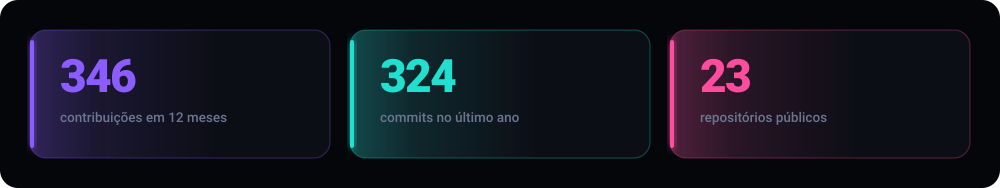

  

<a href="https://www.linkedin.com/in/gabrielvasconcellosgomes"><picture><source media="(prefers-color-scheme: dark)" srcset="https://raw.githubusercontent.com/Gabriell230G/Gabriell230G/main/assets/btn-linkedin-dark.svg"><source media="(prefers-color-scheme: light)" srcset="https://raw.githubusercontent.com/Gabriell230G/Gabriell230G/main/assets/btn-linkedin-light.svg"></picture></a>&nbsp;
<a href="mailto:gabriel.gomes0410@gmail.com"><picture><source media="(prefers-color-scheme: dark)" srcset="https://raw.githubusercontent.com/Gabriell230G/Gabriell230G/main/assets/btn-email-dark.svg"><source media="(prefers-color-scheme: light)" srcset="https://raw.githubusercontent.com/Gabriell230G/Gabriell230G/main/assets/btn-email-light.svg"></picture></a>&nbsp;
<a href="https://github.com/Gabriell230G?tab=repositories"><picture><source media="(prefers-color-scheme: dark)" srcset="https://raw.githubusercontent.com/Gabriell230G/Gabriell230G/main/assets/btn-repos-dark.svg"><source media="(prefers-color-scheme: light)" srcset="https://raw.githubusercontent.com/Gabriell230G/Gabriell230G/main/assets/btn-repos-light.svg"></picture></a>

---

### Sobre mim

<picture>
  <source media="(prefers-color-scheme: dark)" srcset="https://raw.githubusercontent.com/Gabriell230G/Gabriell230G/main/assets/sobre-dark.svg">
  <source media="(prefers-color-scheme: light)" srcset="https://raw.githubusercontent.com/Gabriell230G/Gabriell230G/main/assets/sobre-light.svg">
  
</picture>

---

### Projetos

<a href="https://github.com/Gabriell230G/Tami"><picture>
  <source media="(prefers-color-scheme: dark)" srcset="https://raw.githubusercontent.com/Gabriell230G/Gabriell230G/main/assets/proj-tami-dark.svg">
  <source media="(prefers-color-scheme: light)" srcset="https://raw.githubusercontent.com/Gabriell230G/Gabriell230G/main/assets/proj-tami-light.svg">
  
</picture></a>

<a href="https://gabriell230g.github.io/Tami/"><b>Conhecer a Tami</b></a> &nbsp;➜&nbsp;
<a href="https://tami-app.onrender.com"><b>Testar o app</b></a> &nbsp;➜&nbsp;
<a href="https://youtube.com/shorts/PQwOoTw_ibQ"><b>Pitch</b></a> &nbsp;➜&nbsp;
<a href="https://youtu.be/ulI5rDNCbj8"><b>Vídeo técnico</b></a> &nbsp;➜&nbsp;
<a href="https://github.com/Gabriell230G/Tami"><b>Código</b></a>

 

<a href="https://github.com/Gabriell230G/hackgovProtegeMais"><picture>
  <source media="(prefers-color-scheme: dark)" srcset="https://raw.githubusercontent.com/Gabriell230G/Gabriell230G/main/assets/proj-protege-dark.svg">
  <source media="(prefers-color-scheme: light)" srcset="https://raw.githubusercontent.com/Gabriell230G/Gabriell230G/main/assets/proj-protege-light.svg">
  
</picture></a>

<a href="https://gabriell230g.github.io/hackgovProtegeMais/"><b>Ver a plataforma</b></a> &nbsp;➜&nbsp;
<a href="https://github.com/Gabriell230G/hackgovProtegeMais"><b>Código</b></a> &nbsp;➜&nbsp;
<a href="https://github.com/Gabriell230G/ProtegeMais-Fase-7"><b>Fase 7</b></a>

 

<a href="https://github.com/Gabriell230G/Utopia"><picture>
  <source media="(prefers-color-scheme: dark)" srcset="https://raw.githubusercontent.com/Gabriell230G/Gabriell230G/main/assets/proj-utopia-dark.svg">
  <source media="(prefers-color-scheme: light)" srcset="https://raw.githubusercontent.com/Gabriell230G/Gabriell230G/main/assets/proj-utopia-light.svg">
  
</picture></a>

<a href="https://gabriell230g.github.io/Utopia/"><b>Ver a plataforma</b></a> &nbsp;➜&nbsp;
<a href="https://github.com/Gabriell230G/Utopia"><b>Código</b></a>

<a href="https://github.com/Gabriell230G?tab=repositories">Ver todos os repositórios ➜</a>

---

### No tatame

<picture>
  <source media="(prefers-color-scheme: dark)" srcset="https://raw.githubusercontent.com/Gabriell230G/Gabriell230G/main/assets/medalhas-dark.svg">
  <source media="(prefers-color-scheme: light)" srcset="https://raw.githubusercontent.com/Gabriell230G/Gabriell230G/main/assets/medalhas-light.svg">
  
</picture>

---

### Tecnologias

<picture>
  <source media="(prefers-color-scheme: dark)" srcset="https://raw.githubusercontent.com/Gabriell230G/Gabriell230G/main/assets/tecnologias-dark.svg">
  <source media="(prefers-color-scheme: light)" srcset="https://raw.githubusercontent.com/Gabriell230G/Gabriell230G/main/assets/tecnologias-light.svg">
  
</picture>

---

### Trajetória

<picture>
  <source media="(prefers-color-scheme: dark)" srcset="https://raw.githubusercontent.com/Gabriell230G/Gabriell230G/main/assets/timeline-dark.svg">
  <source media="(prefers-color-scheme: light)" srcset="https://raw.githubusercontent.com/Gabriell230G/Gabriell230G/main/assets/timeline-light.svg">
  
</picture>
<!-- Header, destaques, projetos, botoes e trajetoria saem de .github/scripts/data.mjs.
     Edite la e rode `node .github/scripts/build.mjs` para regerar os SVG.
     As estatisticas sao recalculadas sozinhas pelo workflow .github/workflows/assets.yml. -->

---

### Estatísticas

<picture>
  <source media="(prefers-color-scheme: dark)" srcset="https://raw.githubusercontent.com/Gabriell230G/Gabriell230G/main/assets/stats-dark.svg">
  <source media="(prefers-color-scheme: light)" srcset="https://raw.githubusercontent.com/Gabriell230G/Gabriell230G/main/assets/stats-light.svg">
  
</picture>

  

<picture>
  <source media="(prefers-color-scheme: dark)" srcset="https://raw.githubusercontent.com/Gabriell230G/Gabriell230G/output/github-snake-dark.svg">
  <source media="(prefers-color-scheme: light)" srcset="https://raw.githubusercontent.com/Gabriell230G/Gabriell230G/output/github-snake.svg">
  
</picture>

---

### Fora do teclado

<picture>
  <source media="(prefers-color-scheme: dark)" srcset="https://raw.githubusercontent.com/Gabriell230G/Gabriell230G/main/assets/hobbies-dark.svg">
  <source media="(prefers-color-scheme: light)" srcset="https://raw.githubusercontent.com/Gabriell230G/Gabriell230G/main/assets/hobbies-light.svg">
  
</picture>

 

<picture>
  <source media="(prefers-color-scheme: dark)" srcset="https://raw.githubusercontent.com/Gabriell230G/Gabriell230G/main/assets/frases-dark.svg">
  <source media="(prefers-color-scheme: light)" srcset="https://raw.githubusercontent.com/Gabriell230G/Gabriell230G/main/assets/frases-light.svg">
  
</picture>
